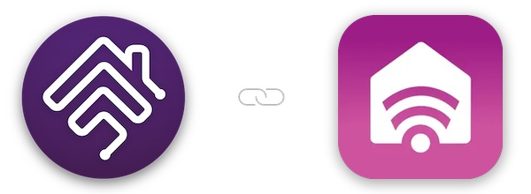

   

## homebridge-smarthq

Homebridge plugin to integrate SmartHQ appliances into HomeKit

 
 

### Plugin Information

- This plugin allows you to view and control your [SmartHQ](https://www.geappliances.com/connect) appliances within HomeKit. The plugin:
  - requires your SmartHQ account credentials to work
  - connects to the SmartHQ cloud to discover and control your appliances

### Prerequisites

- To use this plugin, you will need to already have:
  - [Node](https://nodejs.org): latest version of `v22`, `v24` or `v26` - any other major version is not supported.
  - [Homebridge](https://homebridge.io): `v2` - refer to link for more information and installation instructions.

### Setup

- [Installation](https://github.com/homebridge-plugins/homebridge-smarthq/wiki/Installation)
- [Configuration](https://github.com/homebridge-plugins/homebridge-smarthq/wiki/Configuration)
- [Beta Version](https://github.com/homebridge-plugins/homebridge-smarthq/wiki/Beta-Version)
- [Node Version](https://github.com/homebridge-plugins/homebridge-smarthq/wiki/Node-Version)

### Supported Appliances

- Dishwashers, including Fisher & Paykel DishDrawers
- Ovens
- Refrigerators, including a built-in Keurig K-Cup brewer
- Opal Nugget Ice Makers
- Air conditioners, including portable, split and through-the-wall units
- Hoods
- Clothes washers, clothes dryers and combination washer dryers
- Water filters
- Water softeners
- Water heaters
- Advantium ovens
- Microwaves
- Coffee and espresso makers
- Beverage centers
- Smokers
- Induction cooktops

### Features

- **HomeKit Controller notifications** are supported for the Opal Ice Maker. To set up, install the HomeKit Controller app and configure notifications for each respective event. Put your HomeKit Controller client secret in the plugin advanced options, and the path associated with each available notification in the Opal device options. Supported events:
  - Ice Bucket Full
  - Production Progress Complete
  - Filter Maintenance Change Alert
  - Descale Needed Alert
  - Add Water Alert

- **Estimated energy use for every appliance.** SmartHQ reports no power readings, so with *Show Estimated Energy Use* on, the plugin estimates watts from what each appliance does report and adds them up into kWh. The totals are kept in `smarthq-energy.json` in the Homebridge storage folder, so they survive restarts. Washers, dryers and washer/dryers show the figures on their *Running* tile (it replaces *Show Running Switch*); every other appliance gets an *<Name> Energy* tile. *Energy Tile Protocol* sets how the tile is published:
  - **Matter only (recommended on iOS/iPadOS 27+).** The tile is a Matter outlet (always On for always-on appliances like the fridge) with power and energy measurement. Apple Home shows the watts on the tile and in its Energy view. This needs Homebridge 2.2.1 or later with Matter enabled for the bridge, and the bridge's Matter code added to Apple Home. If Matter is not available, the plugin logs why and uses HAP instead.
  - **HAP.** An outlet carrying Eve's Consumption (W) and Total Consumption (kWh). Apple Home shows On/Off; Eve, Controller for HomeKit and Home+ show the figures. *Show Watts In Apple Home* adds a linked light sensor whose lux reading equals the watts.

  | Appliance | Estimated from | Defaults: standby / motor / heater (W) |
  |---|---|---|
  | Washer | phase, wash temperature, steam cycles | 2 / 150 (spin 400) / 1800 |
  | Dryer | phase, heat setting | 2 / 200 / 2400 |
  | Washer/dryer | wash or dry phase, temperatures | 2 / 150 (spin 400) / 1500 |
  | Dishwasher | running, cycle phase | 1 / 80 / 1200 |
  | DishDrawer | each running drawer | 1 / 60 / 1200 |
  | Oven / range | each cavity: preheating or holding, convection; range cooktop | 3 / 2500 (lower cavity) / 3500 |
  | Induction cooktop | each lit burner and its power level | 1 / - / 2200 per burner |
  | Hood | fan speed, light | 1 / 250 / - |
  | Refrigerator (always on) | daily average, turbo cool/freeze | 45 average / 60 turbo / - |
  | Keurig (in fridge) | tank heating | 1 / - / 700 |
  | Opal ice maker | making ice, defrosting, idle | 2 / 15 / 120 |
  | Air conditioner | power, mode, fan speed, room vs set temperature | 1 / 60 / 900 |
  | Water heater | tank below set point, vacation mode | 3 / - / 550 |
  | Smoker | cooking | 2 / 30 / 800 |
  | Water filter, softener, beverage centre (always on) | fixed average | 2, 3, 35 |
  | Coffee maker, microwave, Advantium | fixed standby, until their state is read | 1, 2, 3 |

  The plugin's settings page has an **Energy** tab:
  - **Overview:** what each appliance is drawing now, today's and this month's kWh, an estimated cost (set your rate per kWh in Advanced Settings or on the Devices tab), a 14-day chart and a log of finished cycles.
  - **Devices:** every appliance's energy options in one table.
  - **Calibrate:** enter what a smart plug or meter measured for one cycle, and get wattages that would have matched it.
  - **Diagnostics:** the readings behind each estimate and why Matter fell back, if it did, with a copy button for bug reports.

  The dashboard reads `smarthq-energy-status.json`, which the plugin writes every 30 seconds while any energy tile is on. Daily totals and cycles are kept in `smarthq-energy-history.json`.

  The washer defaults suit a cold-feed front loader that heats its own water, such as the Fisher & Paykel WH9060P4: a 40 °C cotton wash estimates at about 0.8 kWh, close to its label's 0.75 kWh. Override any of the wattages per device to match your appliance. For example, set heater to 0 for a hot-fed top loader, about 700 for a heat pump dryer, or 4500 for an element water heater.

### Help/About

- [Common Errors](https://github.com/homebridge-plugins/homebridge-smarthq/wiki/Common-Errors)
- [Support Request](https://github.com/homebridge-plugins/homebridge-smarthq/issues/new/choose)
- [Changelog](https://github.com/homebridge-plugins/homebridge-smarthq/blob/latest/CHANGELOG.md)

### Credits

- To [@donavanbecker](https://github.com/donavanbecker): the original creator and maintainer of this plugin.
- To the creators/contributors of [Homebridge](https://homebridge.io) who make this plugin possible.

### Disclaimer

- I am in no way affiliated with SmartHQ or GE Appliances and this plugin is a personal project that I maintain in my free time.
- Use this plugin entirely at your own risk - please see licence for more information.
